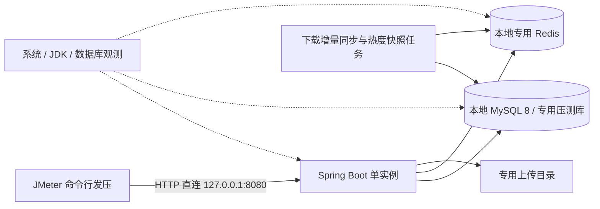

# 本地架构压测流程设计

设计日期：2026-10-27。范围：本地单实例 Spring Boot、MySQL、Redis 和本地文件目录。本文交付流程设计，不代表已运行压测；JMeter 计划、批量造数器和性能报告尚未实现。接口、限流、缓存及统计语义以当前 Java 代码为准。

## 1. 要回答的问题与本地拓扑

压测需要回答：当前本机配置下，哪些接口先达到瓶颈、多少负载可以持续运行、压力消退后是否恢复，以及并发是否造成重复数据或统计偏差。最终给出“机器配置 + 数据规模 + 场景 + 成功吞吐 + 延迟 + 正确性”的完整结论，不预设项目能达到多少 QPS。



- 默认所有组件同机。另有设备时，可让局域网内另一台电脑发压，但后端仍直连本地服务；两种拓扑分别出报告，不混用结果。
- 直接测试后端 API，不经过前端 Vite；本轮不评估浏览器渲染和页面加载。
- 本方案不包含线上服务器、Nginx、HTTPS、公网、CDN、容器资源预算、多实例或集群。
- 同机压测必须同时观察 JMeter 与后端资源；发压端抢占 CPU、内存、磁盘时，结果只能说明同机条件下的表现。

## 2. 测试环境冻结与准入

### 2.1 每轮记录环境

在仓库外的运行记录中填写下表，同一组对比实验保持不变：

| 项目 | 必填内容 |
| --- | --- |
| 代码与工具 | Git commit、JDK / MySQL / Redis / JMeter 版本、操作系统 |
| 本机资源 | CPU 核数、内存、磁盘类型与剩余空间，Redis 是否运行在本地 WSL / 虚拟机 |
| JVM | 独立后端进程 PID、完整 JVM 参数、最大堆、GC、启动方式 |
| 连接与线程 | 实际生效的 Hikari 最大连接数/等待时间、Tomcat 线程数和连接配置 |
| MySQL / Redis | MySQL 连接数与 Buffer Pool、Redis 持久化策略、内存限制、实例端口/DB |
| 业务配置 | 数据规模、文件大小分布、账号数、Token 有效期、定时任务开关与周期 |
| 发压配置 | 同机/局域网、线程数、升压时间、思考时间、超时、请求分布、样本数 |

`application.yaml` 本地仅显式配置 Hikari 连接等待默认 3000 ms，未固定最大连接数、Tomcat 线程数或 JVM 堆。不能套用其他环境的参数，需核对实际生效值；每次只调整一个变量后复测。

### 2.2 隔离数据与启动

1. 准备可丢弃的 MySQL schema，例如 `campus_resource_platform_loadtest`；如果复用本地 MySQL 进程，记录这仍共享 MySQL 实例资源。停止其他项目流量。
2. 初始化表结构前检查 [sql/init.sql](../sql/init.sql)：开头硬编码了 `CREATE DATABASE` 和 `USE campus_resource_platform`。应先复制到仓库外，仅把这两处库名改为专用压测库，再人工核对导入目标；已有库按迁移记录处理，不在日常开发库中试验。
3. 首选独立本地 Redis 实例，例如 `127.0.0.1:6380`，DB 0。只换 Redis DB 不能隔离实例 CPU、内存、持久化和实例级指标；使用此退化方案必须注明，不能进行整实例故障或清理实验。
4. 准备独立上传目录，例如 `C:\campusshare-loadtest\run-a\uploads`，运行证据放 `C:\campusshare-loadtest\evidence\<runId>`。不要复制日常库后只修改上传变量：历史 `file_info.storage_path` 保存的是绝对路径。
5. 按 [本地运行手册](07-project-runbook.md) 注入凭据和 JWT Secret；将 `MYSQL_URL` 指向专用库、`REDIS_HOST/PORT/DATABASE` 指向专用 Redis、`APP_UPLOAD_STORAGE_PATH` 指向本次目录。凭据和 Token 只保存在受控本地环境，不进入 Git 或报告。
6. 正式测量使用同一份已打包 JAR，以 `java -jar` 独立运行，关闭调试器、热更新和无关开发进程。不在测量时编译、安装依赖或造数。先运行必要功能回归再打包，测试也必须确认指向专用数据源。
7. 检查 `GET /api/v1/health` 和 `GET /api/v1/health/readiness`：前者进程可响应，后者应 HTTP 200、`code=0` 且 `data.status="UP"`；再完成一次登录、搜索、上传、审核、收藏及两阶段下载冒烟。`ReadinessVO.ready()` 是服务端判断方法，不作为响应 JSON 字段断言。

正常基线保留下载同步与热榜维护任务开启：下载同步默认固定延迟 60000 ms、每批最多 500 个资料；热度快照与缺榜检查默认 300000 ms。固定延迟从前一轮结束计算。关闭任务只允许作为标明条件的诊断对照，不作为完整系统容量结果。

前置功能回归可在内层后端目录执行 `./mvnw.cmd test`，打包执行 `./mvnw.cmd -DskipTests package`。H2、Mockito 或单元测试通过不能替代真实 MySQL + Redis 压测；测试 classpath 默认关闭后台同步，不能用于正式性能场景。

## 3. 测试数据与用户模型

### 3.1 数据规模

| 数据集 | 建议规模 | 用途 |
| --- | --- | --- |
| 冒烟 | 30～40 份资料、4～8 个普通账号、1 个管理员 | 验证数据与脚本关联；不据此评价搜索容量 |
| 基线 | 1000 份资料、至少 100 个普通账号、1 个管理员 | 搜索、详情、收藏与短时并发 |
| 扩展 | 10000 份资料、至少 100 个普通账号 | 比较模糊查询、排序、深分页成本；基线通过后再准备 |

以上是拟准备规模，当前仓库没有已经验证的千/万级造数工具。现有 [造数脚本](../scripts/seed-homework-test-data.ps1) 限制 `TargetCount` 为 30～40、`UserCount` 为 1～8，可作冒烟；它读取本机作业文件且会产生收藏、下载、搜索与榜单行为，不应直接作为大规模压测默认数据。使用前阅读 [脚本说明](10-bulk-test-data-seeding.md)。

后续造数采用无个人信息的合成文本/文件，通过 API 完成上传授权、资料创建及管理员审核，并输出批次 manifest；不绕过业务直接复制资料行。可在不同用户间合法复用文件，但同一用户、同一文件不能创建多份待审/通过资料。造数耗时不计入压测。

每批包含：约 80% 已通过资料，其余待审、拒绝和下架；至少 5 个分类、多种资料类型、课程和标签，存在高频词、低频词、无命中词。记录实际数量、状态和关键词命中数，比例只是建数目标。分页必须覆盖有数据的深页，不能只压越界空页。

### 3.2 场景数据池

- `users`：普通用户与管理员分开；每个写入虚拟用户使用自己的账号和用户资料组合，避免吞吐实验全部争抢同一行。登录在准备阶段完成并提取 `data.accessToken`，业务循环不反复登录；登录性能单测。
- `resources`：已通过资料 ID、分类、关键词、预期命中；读场景分均匀访问和“80% 请求访问 20% 资料”的热点分布。并发正确性另用专门热点 ID。
- `files`：合法 UTF-8 TXT 等合成文件，建议 100 KiB、1 MiB、10 MiB；边界单测 50 MiB 及超限，不混入正常上传吞吐。新上传每次内容和摘要必须不同，只改文件名会命中去重。
- `baseline`：压测前记录资料计数、收藏状态、文件/授权数量，以及下载待同步状态；等待造数产生的增量完全排空后再取基线。
- 用户、Token 和文件路径清单放仓库外；JMeter CSV 不能循环复用已消费的一次性票据。账号与票据不足时停止场景，不能用旧值继续发压。

## 4. 工具与脚本设计

选用 Apache JMeter 作为独立本地发压工具，不给应用增加 Maven/npm 依赖。本轮不安装工具。GUI 仅用于构建与少量调试，正式运行使用 CLI，关闭结果树等高开销监听器；依据 [JMeter 官方最佳实践](https://jmeter.apache.org/usermanual/best-practices.html)。

后续最小脚本布局建议为 `tests/performance/jmeter/`，依次实现只读、收藏、上传、下载计划。该目录和 `.jmx` 本轮尚未创建，不能声称已有一键压测命令。

每份计划至少包括：

1. HTTP Request Defaults：`http`、`127.0.0.1`、`8080`，路径使用真实 `/api/v1` 前缀；局域网测试显式记录目标 IP。
2. CSV / 变量：可调线程数、持续时间、数据路径、目标地址；不同业务使用独立数据池。每线程在业务循环前固定自己的账号/Token，不能每次循环随机换号污染幂等断言。
3. HTTP Header Manager：受保护 JSON 请求携带 JWT；上传使用 multipart `file`，不沿用 JSON Content-Type；文件 GET 额外携带票据头。
4. JSON 提取器与断言：普通成功必须 HTTP 200、`code=0` 以及对应业务字段正确；当前全局异常处理已映射 4xx/5xx，并非业务失败一律 HTTP 200。鉴权、限流、重复等预期拒绝使用独立标签和断言。
5. 关联失败时终止本次业务链：不得在登录失败、票据提取为空或创建失败后继续发送带旧变量的请求；不自动重试写请求。超时写入记为“结果不确定”，独立对账。
6. 指标分别按单 HTTP 请求和完整业务事务汇总，避免 POST/GET 两阶段样本和父事务重复计算总吞吐。保存状态、耗时、字节数、断言结果；不保存密码、Authorization、票据或完整响应正文。
7. JSON 建连超时初始取 3 秒、响应超时 10 秒；文件响应超时初始取 60 秒，按文件大小与低压结果在正式运行前固定。超时不得在失败后临时调大来掩盖退化。

计划实现后可按 [官方 CLI 用法](https://jmeter.apache.org/usermanual/get-started.html) 执行 `jmeter -n -t <真实计划路径> -l <新结果文件>`，测量结束后再按 [报告生成说明](https://jmeter.apache.org/usermanual/generating-dashboard.html) 从 JTL 生成 HTML，避免同机报告生成干扰测量。`-J` 参数只有计划显式读取对应属性才会生效。

本方案的主负载模型为固定线程的闭合模型：并发数是虚拟用户数，不等于 QPS。真实用户混合场景加入固定或随机 1～3 秒思考时间；单接口容量实验去掉思考时间并注明。服务变慢时闭合模型会自动降速，不能把它宣称为固定到达率或任意 RPS 下的容量保证。

## 5. 场景清单与断言

路径均相对于 `http://127.0.0.1:8080`。每个场景独立运行，先验证再增加压力。

| 编号 | 场景与真实接口 | 数据与检查要点 |
| --- | --- | --- |
| P01 | 搜索 `GET /api/v1/search/resources` | `keyword` 命中/无命中/空值、`categoryId`、课程/标签；`pageNo=1&pageSize=10` 起步，再测有数据的深页和 `pageSize=100`；四种 `sortBy` 分开比较；返回 ID 必须属于 manifest 中的已通过资料集合（搜索 VO 没有 status 字段） |
| P02 | 详情 `GET /api/v1/resources/{id}` | 热缓存、热点冷启动、大量不同 ID、不存在 ID 分组；校验 ID、状态及公共快照不包含他人收藏状态 |
| P03 | 热榜 `GET /api/v1/rankings/resources/hot?period=weekly&limit=10`；热词 `GET /api/v1/rankings/search-keywords/hot?period=daily&limit=10` | 热榜还有 MySQL 状态过滤，不是只读 Redis；分类过滤单列；热词周期不支持 `all`；空榜与有榜分开 |
| P04 | 登录 `POST /api/v1/auth/login`；个人查询 `GET /api/v1/users/me` | 登录独立测 BCrypt 成本；鉴权读使用预登录 Token，校验返回用户属于当前账号；固定 Token 有效期并在测量前确认剩余时间 |
| P05 | 收藏 `POST /api/v1/resources/{id}/favorites`；取消 `DELETE` 同路径 | 吞吐场景每虚拟用户自己的组合按收藏→取消串行执行；并发幂等场景同账号同资料重复 POST，关系与计数只增加一次；重复取消允许 404/40401，不要求全部成功 |
| P06 | 上传 `POST /api/v1/files`；预检 `GET /api/v1/files/check?fileMd5=...&fileSize=...` | 新内容、同内容并发、已授权秒传、未授权预检、负缓存分开；未授权预检 `secondUpload=false,fileId=null`；命中全局文件缓存仍须验证用户授权 |
| P07 | 创建资料 `POST /api/v1/resources` | 按 API DTO 准备已授权文件、有效分类和元数据；同用户同文件竞争，待审/通过最多一条，其余 HTTP 400/code=40002；独立组合才用于写吞吐 |
| P08 | 下载 POST 签票 → GET 文件 | 见下一节；完整业务、限流规则、短时文件并发分开，不能直接套读接口压力档位 |

审核只用于准备数据及小规模竞争/可见性验证，不混入第一轮普通用户容量：按 [API 文档](api/api-reference.md) 使用真实管理员接口，检查并发状态更新只产生有效状态流转及对应审核记录；下架后校验搜索、详情、榜单和下载可见性。冷回填与下架竞态单列，缓存删除失败可能存在 TTL 窗口，应记录实际不一致，不假设跨 MySQL/Redis 强一致。

### 5.1 详情缓存实验

先完成 JVM/JIT 预热，再区分缓存条件：

- 热缓存：对目标已通过资料预取详情，确认对应 `crp:cache:resource:detail:{id}` 存在且 TTL 合理，再运行均匀/热点读。
- 冷热点：仅在专用 Redis 删除本轮明确 ID 的详情缓存，使用同步集合点制造一次并发突发；重新清理目标缓存后才能重复同一冷实验。
- 不存在资料：使用明确不存在的 ID，预期 404/40401；当前无不存在结果负缓存，这属于穿透压力，不混入正常详情错误率。

缓存 TTL 为 30～35 分钟，每资料互斥锁等待最多约 2 秒；锁超时会回源，不能假设任何并发度都只查一次数据库。不删除锁、黑名单、票据、限流或统计 Key，也不使用 `FLUSHDB/FLUSHALL` 制造冷缓存。

### 5.2 下载专项：先业务限制，再性能

创建下载记录接口为 `POST /api/v1/resources/{resourceId}/download-records`。成功后提取 `data.downloadRecordId`、`data.downloadTicket`、`data.downloadUrl`、`data.counted`，立刻 GET 返回的 URL，同时带同账号 JWT 与 `X-Download-Ticket`。票据 60 秒且只能消费一次，禁止将票据放 URL 或自动重放 GET。

| 子场景 | 发压方式 | 验收 |
| --- | --- | --- |
| 完整低速下载 | 单来源 IP 全局约 0.2 次/秒；至少 3 个账号均匀轮换，每账号不超过 6 次/分钟；先小文件再 1/10 MiB | 分别记录 POST 成功、`counted=true`、GET 完整传输成功；文件 HTTP 200、附件头、预期大小，正确性阶段抽样比对内容摘要 |
| 用户限流 | 专用空闲窗口，同账号对有效资料连续发 11 次创建请求，总 IP 次数不足 30 | 前 10 次放行，第 11 次 HTTP 429/code=42901，消息为用户过频；测试前确保无其他流量 |
| IP 限流 | 等窗口恢复，至少 4 个账号轮换，任一账号不超过 10 次，单 IP 合计 31 次创建请求 | 前 30 次放行，第 31 次 IP 限流；先用户后 IP 的校验顺序不能改变 |
| 滑窗恢复 | 从最后一次允许请求后留足超过 60 秒的间隔再发 | 请求重新放行；单独记录时间线，不用 TTL=120 秒误判窗口长度 |
| 短时文件并发 | 新空闲窗口预签 1/5/10/20 张票据，每账号不超过 10 次、总量不超过 20；全部在 60 秒内同时 GET | 每张票据只用一次，度量完整耗时、字节和 MiB/s；每轮重新签票，窗口恢复后再测 |
| 一次性与越权 | 单独准备新票据，重放、过期或换账号取流 | 正确拒绝；重放竞争至多一个成功，不计入正常下载成功率 |

用户限流固定 10 次/60 秒，IP 限流固定 30 次/60 秒，均为 Lua 滑窗且目前常量写在实现中。本机所有账号从同一 IP 发压，长期签票吞吐受约 0.5 次/秒限制；上面的短时 GET 只代表预签票文件读取能力，不能代替持续完整下载容量。局域网单台发压也仍共享一个来源 IP。

不为压测修改生产限流常量或伪造转发头；如未来需要不限流下载容量，须另立范围并单独标注测试变体。429 也可能源于 Redis 执行失败，须按业务消息与日志区分“阈值拒绝”和“限流服务不可用”，后者不能算规则验证通过。

## 6. 统一执行顺序与负载阶梯

```text
环境与数据隔离 → 功能冒烟 → 冻结数据基线 → JVM/连接池预热
→ 单接口逐档增压 → 停压与对账 → 只读混合负载
→ 独立写入/幂等/下载专项 → 稳定性与恢复 → 报告与单变量复测
```

| 阶段 | 初始配置 | 通过后动作 |
| --- | --- | --- |
| 冒烟 | 每场景 1 线程、1～3 次完整链路 | 确认关联、断言、数据与预期状态；有误先修脚本 |
| 预热 | 5 线程，2 分钟；文件场景另用低频小文件预热 | 不计入正式统计；随后再建立指定缓存条件 |
| 单接口基线 | 1 / 5 / 10 / 20 / 50 / 100 线程，每档独立运行，升压 30 秒 + 稳态至少 5 分钟 | 达到停止条件即结束，不强行跑完所有档位；必要时在拐点附近加档 |
| 上传专项 | 1 / 2 / 5 / 10 线程，每种大小分别跑 | 预先保证不同内容文件池与空间；去重与新上传分开 |
| 写入竞争 | 同一键 2 / 5 / 10 / 20 并发，每批重置到确定业务状态 | 重复至少 3 批，对账后继续；不自动删除业务数据作重置 |
| 只读混合 | 搜索 50%、详情 35%、资料榜 10%、热词榜 5%，从 10 / 20 / 50 线程起 | 比例为无访问日志时的初始假设；按请求数核验实际比例，各接口单独统计 |
| 稳定性 | 取已通过的最高负载的 60%～70%，持续 30～60 分钟 | 保持后台任务启用，观察至少多个 5 分钟任务周期；小于 1 线程时取 1 |
| 恢复 | 降至 1 线程/停止发压，观察 5～10 分钟并等待增量排空 | 响应恢复、待处理任务收敛，核对数据与文件残留 |

下载使用第 5.2 节的独立档位，不参与通用 100 线程实验。混合场景先采用只读请求，避免用任意下载比例触发本机 IP 限流；写操作通过各专项评估，后续取得真实用户分布再设计业务混合轮次。

正式报告剔除预热、升压、停压时间；缓存冷突发单独出时间线，不能用后续长时间热命中稀释。低吞吐场景按实际样本数解释分位数；单场景/稳态样本不足 1000 时，P99 只作参考并同时列样本数和最大值。稳定档重复 3 次，写场景每次重新取基线；搜索虽然是 GET，也会更新热词榜，因此对比前须记录/建立相同榜单条件；报告各轮结果及中位值，不只挑最好的一轮。

闭合负载下若增加线程后吞吐基本不涨、延迟和错误持续上升，记为候选拐点，并结合资源与发压端判断原因。最后一个同时满足性能目标、无资源持续恶化且正确性通过的档位，才可列为“本轮可持续负载”；未跑满不得宣称最大容量。

## 7. 指标、初始目标与停止条件

### 7.1 指标与观测方法

| 层次 | 指标 | 本地获取方式 |
| --- | --- | --- |
| 客户端 | 发出/完成请求数、成功 QPS、全部尝试 QPS、预期拒绝率、非预期失败率、P50/P95/P99/最大值、超时、字节、完整事务成功率 | JMeter JTL/HTML，分场景与时间窗；单列结果不确定写入 |
| 发压端和主机 | JMeter 与 Java 分进程 CPU/内存、主机可用内存、分页、磁盘吞吐/延迟、局域网带宽 | 任务管理器/资源监视器，或本地已有的系统采样工具；固定 5～10 秒采样 |
| JVM | 堆、GC 次数/停顿、线程与阻塞、异常趋势 | JDK `jcmd`、`jstat` 与应用日志；JFR/线程转储放在复现轮次，记录其采样开销 |
| MySQL | 查询耗时与执行计划、连接/活跃线程、锁等待与死锁、慢查询、读写量 | 已有慢日志、`SHOW GLOBAL STATUS`、`SHOW ENGINE INNODB STATUS`、performance_schema；按起止差值看累计项，针对具体 SQL 做 EXPLAIN |
| Redis | 内存、客户端/阻塞、命中未命中、命令速率、淘汰、慢命令、待同步 Hash 与批次 | `INFO`、`SLOWLOG`、定向 HLEN/HGET/SCAN；命中率是实例级辅助指标，不能直接当详情缓存命中率 |
| 文件与任务 | 有效文件字节、文件/授权关系、`.part` 残留、磁盘余量、批次排空时间与告警 | manifest、MySQL 查询、目录检查、应用任务日志，停压后核对 |

当前 `pom.xml` 没有 Actuator、Micrometer 或 Prometheus，任务监控只有进程内快照和日志；本方案不假设存在 `/actuator/prometheus` 或任务查询 API。readiness 每次会访问数据库、PING Redis 并创建/删除目录探针，最多每 5～10 秒采样且从业务吞吐剔除。禁止持续 `MONITOR` 或全量 `KEYS *` 干扰测量。

### 7.2 初始目标（待本机基线验证）

| 场景 | 暂定验收目标 |
| --- | --- |
| 热详情 / 热榜 / 鉴权读 | P95 ≤ 200 ms，P99 ≤ 500 ms |
| 搜索 | P95 ≤ 500 ms，P99 ≤ 1000 ms；分别按数据规模、过滤、排序和分页统计 |
| 收藏状态变更 / 签票 | P95 ≤ 500 ms；签票必须先符合限流预算 |
| 文件传输 | 暂不拍固定 QPS；按文件大小报告完整耗时、成功字节和 MiB/s，与同条件低压基线比较 |
| 通用正确性 | 非预期失败率 < 1%，数据一致性断言全部通过；有效重复关系、越权成功和重复计数容忍数为 0 |

这些是首次实验的建议门槛，不是已测结果或生产 SLA。正常容量场景中的非预期 4xx、5xx、超时和断言失败都计失败；专项预期 429/404/重复拒绝另列“规则符合率”，不能汇入正常成功 QPS。健康探针、准备登录、造数及预热请求不参与业务指标。

### 7.3 停止与恢复

出现以下任一情况停止继续升压，保留在途请求结果和现场：

- 数据错误、重复有效记录、越权成功、文件内容损坏或计数负值，立即结束本轮。
- 非预期失败率连续 1 分钟 > 5%，或 P95 连续 1 分钟超过该场景目标 2 倍。
- OOM、进程退出、持续大量换页、数据库死锁反复发生、Redis 拒写/异常淘汰、连接池持续等待超时。
- 主机 CPU 连续 1 分钟 > 90% 且延迟持续恶化，或可用内存连续 1 分钟不足 10%；分别判断后端与发压端，发压端饱和则不能归因于服务端。
- 上传盘余量低于“本轮预计新增字节 + 1 GiB”，或低于应用配置水位。默认应用水位 256 MiB，只是最终保护，不应压到此处才停。

停止后先降载观察并收集进程、锁、日志与待同步批次，避免立即重启掩盖原因。数据正确性失败后不得直接进入下一场景；纯性能瓶颈可记录后在独立轮次复现。报告恢复耗时，并把结果不确定请求留待对账。

## 8. 停压后的业务对账

### 8.1 收藏、文件与资料

- 收藏：直接对 MySQL 聚合 `favorite.status=1`，与 `resource.favorite_count` 比较，并检查 `(user_id,resource_id)` 唯一关系。详情中的计数是缓存快照，TTL 内滞后不能据此判定数据库错误。
- 文件：同 `file_md5 + file_size` 只保留一个有效文件记录；用户授权齐全，路径指向实际文件，大小/摘要正确，停压和在途完成后无遗留 `.part` 或无引用的多余物理副本。
- 资料：同 `(uploader_id,file_id)` 的待审核/已通过资料最多一条；状态与审核记录一致，非公开资料不出现在公开查询中。

下面只读 SQL 在专用压测库执行；本轮使用独立库时可以查全库，否则必须按 manifest 限定本轮 ID：

```sql
-- 返回行表示数据库收藏计数不一致；不能用详情缓存代替此核验。
SELECT r.id, r.favorite_count, COALESCE(f.actual_count, 0) AS actual_count
FROM resource r
LEFT JOIN (
    SELECT resource_id, COUNT(*) AS actual_count
    FROM favorite WHERE status = 1 GROUP BY resource_id
) f ON f.resource_id = r.id
WHERE r.favorite_count <> COALESCE(f.actual_count, 0);

-- 有效资料重复组应为零，生成列唯一约束还需在真实 MySQL 下验证。
SELECT uploader_id, file_id, COUNT(*) AS duplicate_count
FROM resource WHERE status IN (0, 1)
GROUP BY uploader_id, file_id HAVING COUNT(*) > 1;
```

### 8.2 下载增量

1. 正常实验前确认无历史待处理增量，记录每个目标资料 `download_count_before`。
2. 逐资料统计本轮成功 POST 响应中的 `counted=true`；同用户同资料 10 分钟内只计一次，重复签票仍可新增流水。另存 POST 成功数与完整 GET 数。
3. 停止所有写请求，保持同步任务和依赖正常。默认每轮最多处理 500 个资料，不是 500 次下载；超过 500 个资料或有重试时须等待多轮。
4. 定向检查 `crp:stats:resource:download:delta`、`crp:stats:resource:download:syncing:current` 和 `crp:stats:resource:download:syncing:{batchId}`；用 SCAN 检查本专用实例可能遗留的 UUID 批次，排除 current 这个 String 后核对各 Hash。只看 delta 为空不代表同步完成。
5. 所有待处理增量/批次清空并连续两次检查稳定（两次至少间隔一个下载同步周期），再读取 `download_count_after`；配合任务/业务告警与 `download_delta_sync_item` 批次幂等记录核对。任务日志 `COMPLETED` 不足以证明落库，因为 Service 内部可能捕获异常后保留批次。
6. 在无故障、无超时丢响应、无其他流量的轮次，逐资料验证 `after - before = counted=true 数量`。超过预设等待预算仍未排空，判定本轮未完成，保留批次；不要删统计 Key 来“修复”。建议先按 `max(5分钟, (ceil(涉及资料数/500)+2)×60秒)` 设初始观察预算，任务耗时与重试会延长它。

下载计数发生在签票阶段，不能与文件 GET 完成数或下载流水数直接画等号。流水、Redis 票据、SETNX 去重和 HINCRBY 不构成跨库事务；`counted=false` 也可能源于统计异常。无故障对账必须同时检查告警；存在超时、Redis 故障或响应丢失时，结果标记为需服务端核对，不能套上面的等式宣称无丢失。

## 9. 可选本地故障专项

只在基础性能和正确性通过、确认依赖属于本轮独立实例后开展，每次只注入一种故障。基线压测不停止依赖：

- Redis 暂停：游客详情/搜索尝试回源 MySQL；资料热榜可降级为 MySQL 快照，热词榜可返回空列表。所有受保护请求先查 Token 黑名单，整个 Redis 故障会阻断鉴权，不能因为收藏 Service 有降级就期待 HTTP 收藏仍成功。
- MySQL 暂停：readiness 应失败，业务返回可解释错误；恢复后观察连接恢复、任务批次处理和重复累计情况，不将故障期请求混入正常容量报告。
- 不做通过填满磁盘来验证上传保护的实验；若要改变本地水位，应作为独立配置实验，记录配置且保留足够空间。

每次故障前后都核对正确性；Redis/MySQL 故障窗口内的计数不承诺强一致。恢复正常依赖、配置和数据基线后才继续正常场景。

## 10. 报告模板与最小实施顺序

每次运行保留环境表、manifest 摘要、JTL、HTML、资源时间线、脱敏日志、对账结果；原始凭据、Token、票据、用户信息不进入报告。报告表至少包含：

| runId/commit | 场景/数据规模/缓存条件 | 并发/时长/样本数 | 成功 QPS/尝试 QPS | P95/P99 | 非预期失败/预期拒绝 | CPU/内存/IO/GC | 对账/恢复 | 结论 |
| --- | --- | --- | --- | --- | --- | --- | --- | --- |
| 待实测 | 待实测 | 待实测 | 待实测 | 待实测 | 待实测 | 待实测 | 待实测 | 不填推测性能 |

留存报告后，先确认已停压、在途请求结束且统计对账完成，再停止本轮后端。需要重建数据时，只处理已核实归属本轮的专用库、独立 Redis 实例和上传目录；保留 manifest 与证据，不能对共享实例或日常开发数据执行清理。

瓶颈结论必须有证据：如搜索慢且 SQL 扫描行数随规模增长；详情热缓存改善且 MySQL 查询量减少；收藏热点锁等待上升；上传磁盘延迟和真实新增字节同步增加。单凭 CPU 高或一次失败不能决定优化方向。每次只改一个参数/索引/实现，再使用相同数据、缓存条件、负载和完整断言复测。

后续拆为可独立验证的小任务：

1. 准备专用本地实例、合成数据与 manifest，验证隔离和完整冒烟。
2. 实现 P01～P03 只读 JMeter 计划，1 线程验证关联与断言后完成逐档基线。
3. 实现 P05 收藏幂等/吞吐及停压 SQL 对账，再独立补 P06/P07 上传与资料竞争。
4. 实现 P08 低速完整下载、用户/IP 限流、一次性票据、短时文件并发及增量对账。
5. 运行混合、稳定性、恢复和可选故障实验，生成真实报告及优化前后对比。

本轮只完成设计和代码静态核对：未新增依赖、JMX、数据结构、接口或 Redis Key，未执行 Maven 测试、造数、真实压测或故障注入。后续脚本实施与压测需按上述顺序单独执行，不能将本文的目标值写成项目成绩。

## 11. 核查依据

- [本地 application.yaml](../campus-resource-platform/src/main/resources/application.yaml)、[pom.xml](../campus-resource-platform/pom.xml)、[测试配置](../campus-resource-platform/src/test/resources/application.properties)。
- [真实 API](api/api-reference.md)、[总体架构](modules/00-overall-architecture.md)、[Redis 设计](05-redis-design.md)。模块历史描述与实现不一致处以当前代码为准，本轮不扩展修订其他模块文档。
- [下载 Service](../campus-resource-platform/src/main/java/com/john/campus/service/impl/DownloadServiceImpl.java)、[下载限流](../campus-resource-platform/src/main/java/com/john/campus/service/impl/DownloadRateLimiterImpl.java)、[下载同步](../campus-resource-platform/src/main/java/com/john/campus/service/impl/DownloadDeltaSyncServiceImpl.java)。
- [收藏 Service](../campus-resource-platform/src/main/java/com/john/campus/service/impl/FavoriteServiceImpl.java)、[详情缓存](../campus-resource-platform/src/main/java/com/john/campus/service/impl/ResourceDetailCacheServiceImpl.java)、[Redis Key 定义](../campus-resource-platform/src/main/java/com/john/campus/common/RedisKeyConstants.java)。
- [本地数据保护](LOCAL-DATA-PROTECTION.md)：日常开发数据需要保留时先按该手册处理。压测使用独立数据集；现有造数脚本没有完整联动清理 API，不在原开发库批量删行清场。
