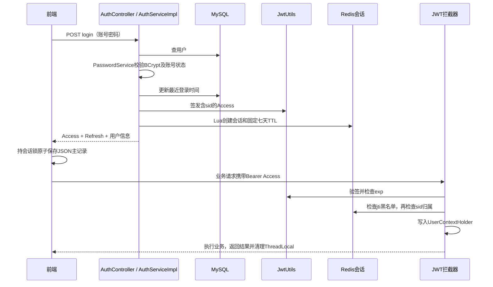
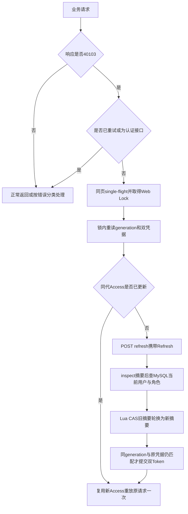

# 登录双 Token 生命周期与自动刷新

## 1. 实现与交付状态

本指南对应原 `codex/auth-auto-refresh` 的后端 `abf8a403`、前端 `aa5b4f7f`，现已于 2026-11-02 合入 `main`。网站现已停止维护，本次未部署，不代表生产环境已具备这些能力。

认证使用 **短期 JWT Access + 可轮换的 opaque Refresh + Redis 会话撤销**。JWT 可以携带自包含身份，但鉴权依赖 Redis 黑名单和会话，整个系统并非完全无状态。自动刷新在业务请求收到 40103 后按需触发，没有后台续期计时器，也不会每次打开页面主动续期。

接口契约见 [API 认证章节](../api/api-reference.md#3-用户认证模块)，实现类见 [认证模块记录](01-auth-development-process.md)，Key 权威设计见 [Redis 登录 Token](../05-redis-design.md#9-登录-token)。

## 2. 凭据与状态

| 对象 | 内容 | 保存位置与期限 |
| --- | --- | --- |
| Access | HS256 签名 JWT，含下表声明 | 前端；默认 900 秒，`JWT_EXPIRATION_SECONDS` 可覆盖；不能超过会话剩余期限 |
| Refresh | `sid.secret`，不是 JWT；sid 为 16 字节安全随机数的 32 位十六进制，secret 为 32 字节安全随机数的 43 字符 Base64URL | 前端持明文，Redis 仅保存 SHA-256 摘要 |
| Redis 会话 | `crp:auth:session:{sid}` Hash | 登录起固定 604800 秒；代码常量 `AuthSessionService.SESSION_SECONDS`，当前没有 Refresh TTL 环境变量 |
| 旧 Token 黑名单 | `crp:auth:token:blacklist:{jti}` String，值 `logout` | 旧 Bearer 退出兼容路径写入，TTL 为 Access 剩余秒数 |
| 浏览器主记录 | `crp.auth-session` JSON：generation、accessToken、refreshToken、user | 原子保存完整双凭据；旧 `crp.access-token`、`crp.current-user` 仅兼容镜像 |

| Access 声明 | 含义 |
| --- | --- |
| `sub` / `userId` | 用户标识 |
| `role` | 签发时的角色快照，刷新从 MySQL 读取最新角色 |
| `jti` | 每个 Access 独立的随机唯一标识 |
| `sid` | 本次登录会话标识，供服务端撤销 |
| `iat` / `exp` | 签发与到期时间 |

HS256 提供完整性校验，JWT 载荷可解码，不能存密码或秘密。Redis Hash 中 `userId` 保存归属、`currentHash` 保存当前 Refresh 摘要、`used:<hash>` 记录已用摘要。轮换不延长 TTL；每会话最多 2048 次轮换，超过后删除会话并要求重新登录，避免高频刷新无限增长 Hash。

## 3. 从登录到正常请求



登录校验失败不会返回凭据；Redis 会话创建成功后才返回登录结果。登录的 MySQL 事务不能回滚 Redis；若最终数据库提交失败，可能留下未返回客户端的孤立会话，由七天 TTL 回收。

受保护请求依次执行：请求头格式 → JWT 验签/到期 → jti 黑名单 → 新 Token 的 sid 会话存在且 `userId` 匹配 → 写请求上下文。业务层继续检查角色、资源归属等权限；请求结束清理 ThreadLocal。登录、注册、刷新、退出以及配置中明确放行的公开接口不走统一 Access 拦截，其中刷新和退出在 Service 自行认证。

普通业务请求不会改变 `exp`，也不会延长 Redis TTL。登录一次得到一个 sid；另一设备再次登录得到独立会话。升级前没有 sid 的 Access 继续使用旧验签/过期/黑名单路径，不能凭空获得 Refresh，需重新登录。

## 4. Access 到期后的自动刷新



`AuthSessionService.inspect` 先验证 Refresh：当前摘要匹配才继续；已知 used 摘要重放会删除整个会话；随机猜测只拒绝，不踢掉合法会话。随后 `AuthServiceImpl.refresh` 查 MySQL：用户不存在或禁用则撤销会话并返回 40104；数据库异常不会消耗 Refresh。按最新角色准备新 Access，扣除查库耗时以免超过会话期限，最后 Lua CAS 原子轮换摘要并记录旧摘要，返回新双 Token。

CAS 只修改仍存在且旧摘要匹配的同一会话，不重新创建已退出的会话，不设置新 TTL。新 Access 使用新 jti、相同 sid。刷新本身不撤销仍在期限内的旧 Access；退出删除 sid 后，同一会话的新旧 Access 才一起失效。

前端并发控制：

- 同页多个到期请求共享一个刷新 Promise；晚到的旧 40103 若发现同 generation 的 Access 已更新，就复用结果，不再刷新。
- Web Lock `crp.auth-session` 覆盖刷新 HTTP 与提交、退出 HTTP 与清理、登录结果提交、资料更新和错误清理。锁内重读主记录，避免跨页检查与写入竞态。
- generation 在登录/清理时改变，刷新时保持；旧账号操作不能以新账号重放，晚到响应不能覆盖新登录，旧错误不能清除新凭据。storage 事件同步其他标签页。
- 用户资料刷新只更新同代 user，保留已经轮换的凭据。
- JSON 和 Blob 文件流都使用统一认证编排。仅 JWT 拦截器返回的 40103 可刷新后重放一次；下载仍携带原 `X-Download-Ticket`，此时下载业务尚未消费票据。票据无效/过期/重放实际为 HTTP 409 / 40901，不刷新、不重放、不清会话。
- 登录、注册、刷新、退出自身禁止递归刷新；重试仍失败不再循环。

## 5. 退出、自然过期与失效顺序

新客户端 `POST /api/v1/auth/logout` 提交 Refresh；Access 已过期也可退出。Lua 在会话存在时接受当前或已用的合法摘要后删除 sid，因此刷新先执行、退出先执行都不会把会话复活。请求已通过鉴权并开始执行的业务不会被主动取消。

退出立即设置本页 logoutPending，阻止新刷新/业务重放；等待在途刷新完整提交，再在相同锁内取最新 Refresh 撤销。后端成功或终态认证错误时条件清理本地；网络/500 保留凭据便于重试。

旧客户端无 Refresh 时，**完全不传 body**，仅使用有效 Bearer；Service 验签后删除 sid（若有）并写当前 jti 黑名单。传 `{}` 与无 body 不同：body 存在但缺少 `refreshToken` 会返回 40001，不会回退 Bearer。前端兼容旧 Access 已过期的情况，将退出返回的 40103 视为终态并清理本地。

Refresh 退出的幂等边界：格式合法但 sid 已不存在时直接成功，不会核验未知 secret；sid 仍存在时伪造摘要才返回 40104。格式非法仍为 40104。不能把幂等退出描述成任意 Refresh 都能认证成功。

自然到期不需要删除客户端 JWT；下一次请求检查 `exp` 即拒绝。Redis 会话七天到期后自动消失，不能继续刷新。错误有先后顺序：已删 sid 的 Access 若已经过期，先返回 40103；未过期但命中黑名单先返回 40102；只有未过期且未命中黑名单，才会查 sid 并返回 40105。

| 错误码 | HTTP | 含义与前端行为 |
| --- | --- | --- |
| 40001 | 400 | DTO 参数错误，含空 Refresh 或长度超过 128 |
| 40101 | 401 | 缺少/无效 Access、签名错误或登录密码错误；不自动刷新 |
| 40102 | 401 | 命中 jti 黑名单；不自动刷新 |
| 40103 | 401 | Access 到期；仅符合条件的业务请求自动刷新一次 |
| 40104 | 401 | Refresh 无效、过期、已用重放、超轮换上限等；刷新失败条件清理匹配会话 |
| 40105 | 401 | sid 不存在或用户归属不匹配；不自动刷新 |
| 40301 | 403 | 无权限或登录时账号禁用；不自动刷新 |
| 40901 | 409 | 包括无效下载票据；不刷新、不重放 |
| 50001 / 网络失败 | 500 / 无响应 | 保留凭据，不冒充 Refresh 失效 |

请求层不是每次 401 立即跳转登录页：清理仍匹配原快照的会话后，后续受保护导航由路由守卫跳转。账号封禁/降权不会统一即时使所有旧 Access 失效；刷新会检查最新状态，但用户级 Token version、全设备撤销 API 尚未实现。

## 6. 脱敏接口示例

登录 `POST /api/v1/auth/login`：

```json
{"username":"<用户名>","password":"<密码>"}
```

成功响应（字段与 AuthLoginVO / UserVO 一致；值仅为占位示例）：

```json
{
  "code": 0,
  "message": "success",
  "data": {
    "accessToken": "<Access Token>",
    "tokenType": "Bearer",
    "expiresIn": 900,
    "user": {"userId": 10001, "username": "<用户名>", "nickname": "<昵称>", "email": null, "role": 1, "status": 1},
    "refreshToken": "<sid.secret>",
    "refreshExpiresIn": 604800
  },
  "traceId": "<traceId>"
}
```

刷新 `POST /api/v1/auth/refresh` 与新客户端退出 `POST /api/v1/auth/logout` 都使用下面的请求 body；刷新不要求有效 Access，返回完整双 Token 响应，`refreshExpiresIn` 会递减，退出返回 `data:null`：

```json
{"refreshToken":"<当前 Refresh Token>"}
```

```json
{"code":0,"message":"success","data":null,"traceId":"<traceId>"}
```

刷新请求 body 必填，字段非空且最长 128 字符；退出 body 可省略，但存在时采用相同校验。旧 Postman 集合的 Logout 无 body，可验证 Bearer 兼容路径；其中名为 “Refresh Token For Resource Tests” 的旧条目实际调用 login 重新登录，不是真实 refresh 验证。本轮不改 JSON 集合，真实刷新按 [API 3.5](../api/api-reference.md#35-刷新登录凭据) 手工构造。

## 7. 配置、验证与现有限制

- Access 默认 900 秒；已有部署 `.env` 的显式 `JWT_EXPIRATION_SECONDS=7200` 不会因示例更新自动改变，需按部署流程主动更新配置。
- Refresh 七天来自代码常量；无虚构的 `REFRESH_TOKEN_TTL` 环境变量。
- 更换 JWT_SECRET 会使旧 Access 验签失败，但 opaque Refresh 不依赖 JWT 签名，仍可能直接刷新得到新 Access。前端 40101 不自动刷新，不能据此宣称服务端 Refresh 已撤销；Redis 会话需要单独撤销，当前无全量撤销 API。不要用清空整个 Redis 的方式替代会话管理。
- Refresh 作为 bearer secret 沿用 localStorage，同源 JavaScript 可读取；XSS 可窃取凭据，尚未使用 HttpOnly Cookie/BFF 隔离。实际凭据不写日志、URL、文档或 Git。
- 无 Web Locks 的浏览器只有同页队列与快照保护，多标签页刷新可能触发重放防护并要求重新登录。没有宣称真实多浏览器协作验收通过。
- Redis 不可用时认证失败关闭，返回 50001；普通接口也没有“只验 JWT 或查 MySQL 后放行”的降级。

上轮代码验证结果：后端认证及已有 Controller 本地 mock/unit **58/58**，前端 **101/101**，前端类型检查和生产构建通过；既有大包警告不影响构建。**本轮纯文档同步未重跑业务测试**，也未执行 Docker/真实 MySQL/Redis 集成或生产部署。

以下命令供后续复验，从仓库根目录执行：

```powershell
.\campus-resource-platform\mvnw.cmd -f campus-resource-platform/pom.xml "-Dtest=JwtUtilsTest,AuthServiceRefreshTest,AuthSessionServiceTest,*ControllerTest,JwtAuthenticationInterceptorTest" test
npm --prefix frontend run test:unit
npm --prefix frontend run build
```

可选本地手工步骤（**未执行**，需已有可用的本地 MySQL/Redis，不要求 Docker）：

1. 在启动后端的终端设置 `$env:JWT_EXPIRATION_SECONDS = '5'`，保留已有安全凭据配置，重启后端；用前端重新登录。
2. 等待至少六秒后发起受保护操作，观察原请求 40103 → 一次 refresh → 原请求成功。并发操作应共享刷新；不要导出包含凭据的网络日志。
3. 退出后确认再次使用旧 Access 在其仍有效时被拒绝；到期后的优先错误是 40103，不能要求所有状态都为 40105。
4. 测试后执行 `Remove-Item Env:JWT_EXPIRATION_SECONDS -ErrorAction SilentlyContinue` 并重启，回到应用默认 900 秒；若原环境有显式值，应恢复原值。既有短期 Token 的 exp 不会随配置恢复而改变，需重新登录。
